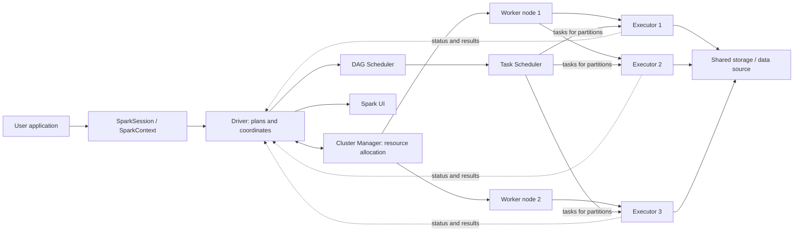
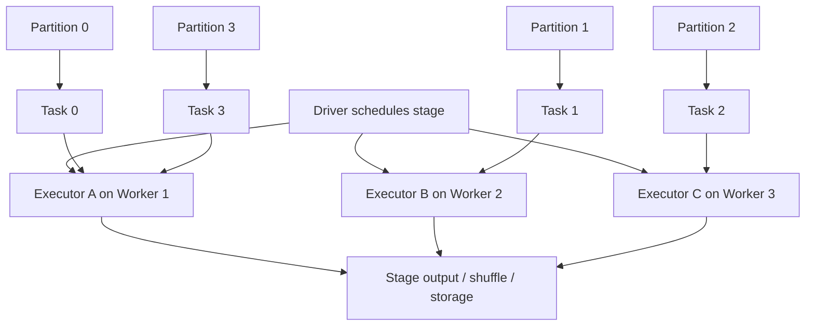
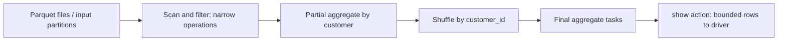
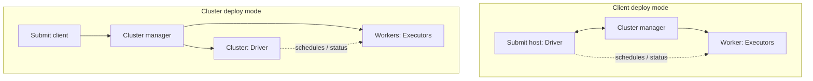
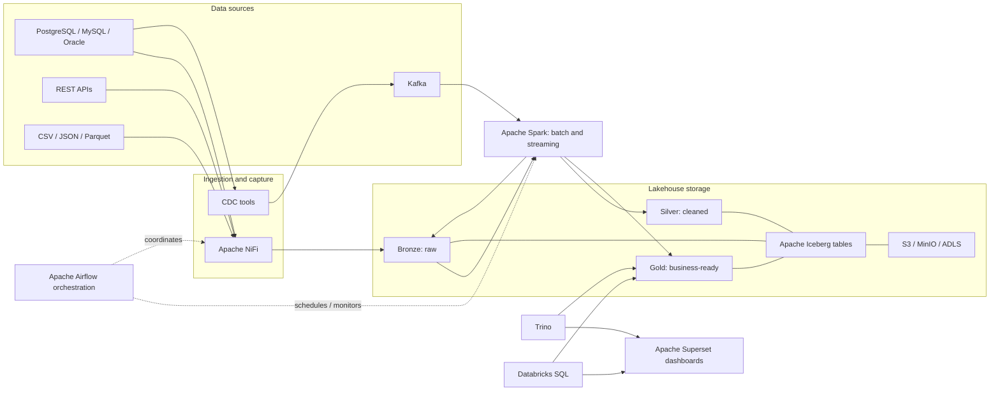
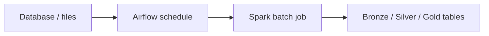
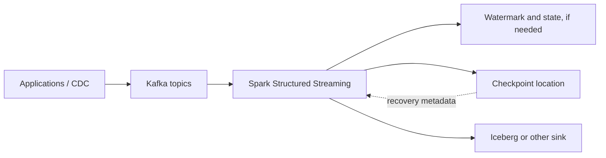

# Apache Spark for Data Engineering

A practical, beginner-to-advanced guide to Apache Spark: its distributed architecture, execution model, performance characteristics, streaming capabilities, and role in a modern data platform. Examples use PySpark and are intended as learning templates; production deployments should pin compatible Spark, Python, connector, and table-format versions.

> **Version note:** This guide targets Apache Spark 4.x concepts and APIs. Spark behavior can vary by minor release, runtime, catalog, and connector. Consult the documentation for the exact version you deploy: [Spark 4.0 documentation](https://spark.apache.org/docs/4.0.0/) and [latest Spark documentation](https://spark.apache.org/docs/latest/).

## Table of contents

- [1. Introduction](#1-introduction-to-apache-spark)
- [2. Architecture](#2-apache-spark-architecture)
- [3. The driver](#3-deep-dive-the-spark-driver)
- [4. Executors](#4-deep-dive-spark-executors)
- [5. Jobs, stages, tasks, and partitions](#5-jobs-stages-tasks-and-partitions)
- [6. Transformations and actions](#6-transformations-and-actions)
- [7. Processing internals](#7-spark-data-processing-internals)
- [8. Deployment modes](#8-spark-deployment-modes)
- [9. Spark in data engineering](#9-spark-in-real-world-data-engineering)
- [10. Batch and streaming](#10-spark-batch-vs-streaming)
- [11. Performance optimization](#11-performance-optimization)
- [12. Common errors and troubleshooting](#12-common-errors-and-troubleshooting)
- [13. Practical PySpark project](#13-practical-pyspark-project)
- [14. Commands and configuration](#14-important-spark-commands-and-configuration)
- [15. Interview questions](#15-spark-interview-questions)
- [References](#references)

## 1. Introduction to Apache Spark

### What it is and why it exists

Apache Spark is an open-source distributed computing engine for processing data across a cluster. Applications can use SQL, DataFrames, RDDs, Structured Streaming, and libraries such as MLlib. Spark was created to make iterative and interactive workloads more efficient and expressive than repeatedly writing intermediate results to disk in traditional MapReduce workflows.

A single machine has finite CPU, memory, and I/O capacity. **Distributed computing** splits a workload and data across networked machines; **parallel processing** runs independent pieces at the same time. Spark represents data as partitions, plans computations, and schedules tasks to executors. It can keep reusable intermediate data in memory, but it also reads and writes durable storage and spills intermediate data to disk when needed. It is not automatically faster: small jobs, poor partitioning, expensive shuffles, skew, or remote I/O can make it slower than simpler tools.

Spark is important in data engineering because it handles large-scale ETL, joins, aggregations, machine-learning preparation, and both batch and streaming pipelines, while integrating with object stores, lakehouse formats, message brokers, and SQL engines.

### Choosing a processing tool

| Tool | Good fit | Strengths | Limitations |
|---|---|---|---|
| Traditional Python | Small files, APIs, control tasks, custom logic | Simple, flexible, rich ecosystem | Usually one process; memory/CPU bounded unless parallelism is built explicitly |
| Pandas | In-memory analysis on a single machine | Excellent interactive analysis and broad APIs | Data generally must fit in one machine's memory; scaling requires other tools |
| SQL database | Transactional workloads and data comfortably managed by a database | Indexes, transactions, mature SQL, concurrency controls | Not always suited to scanning and transforming very large lake data; compute/storage coupling varies |
| Hadoop MapReduce | Durable, large-scale batch processing, especially existing Hadoop estates | Fault-tolerant distributed execution and disk-backed intermediate data | More verbose; repeated disk materialization can add latency for multi-step/iterative jobs |
| Apache Spark | Distributed batch, SQL, and streaming workloads | Unified APIs, optimized query execution, parallelism, caching and broad ecosystem | Cluster and shuffle tuning complexity; network and memory costs; not ideal for every small workload |

## 2. Apache Spark architecture

### Main components

- **Driver:** Runs the application’s control process. It builds plans, requests resources, schedules work, and tracks execution. It does not normally process every row itself.
- **SparkSession:** Main entry point for DataFrame/SQL applications. It exposes DataFrame readers, SQL, catalogs, and runtime SQL configuration. In modern applications it manages or gives access to the underlying context.
- **SparkContext:** Core connection to the Spark execution environment and cluster services. Most DataFrame applications use it indirectly through `SparkSession`.
- **Cluster manager:** Allocates resources to applications. Supported choices include Spark Standalone, YARN, and Kubernetes (plus local mode for development). It allocates resources; it does not execute Spark SQL logic.
- **Worker node:** A machine/container host where executor processes may run. A worker is not the same thing as an executor.
- **Executor:** A process for an application on a worker. It executes tasks and may cache/shuffle data. Executors are generally dedicated to an application for its lifetime.
- **Job, stage, task:** An action submits a job; the DAG scheduler divides it into stages around shuffle boundaries; a task is typically one partition's work within a stage.
- **Schedulers:** The DAG scheduler creates stages and tracks dependencies. The task scheduler launches tasks on available executors, taking locality and resource availability into account.
- **Spark UI:** Web interface showing jobs, stages, SQL plans, executors, storage, and environment/configuration details. The application UI is commonly available on port 4040 while running (port selection can vary); event logs/history server can provide post-run history when configured.



**How to read it:** The application starts in the driver. The driver asks the cluster manager for resources; executors start on workers. The driver sends tasks to executors, which read their input partitions, compute in parallel, and report status/results. Data usually comes from shared storage or services rather than being routed through the driver. The driver coordinates; executors execute.

**Analogy:** The driver is a project coordinator who divides a large job into work orders. The cluster manager finds available workspaces, workers are those workspaces, and executors are teams stationed there. Tasks are individual work orders and partitions are the portions of the data. The coordinator tracks progress but should not ask every team to send the entire dataset back to the office.

## 3. Deep dive: the Spark driver

The driver is the process running the application’s main function. On startup it creates the Spark session/context, connects to the configured cluster manager, negotiates resources, and initializes scheduling and monitoring components. As code constructs DataFrame expressions, Spark builds a logical plan; when an action is invoked, Spark analyzes and optimizes the plan, creates a physical plan, forms jobs/stages/tasks, and dispatches tasks to executors.

The driver communicates with executors through Spark’s internal RPC and scheduling mechanisms. Executors report heartbeats, task status, and metrics; depending on the operation, task results or metadata can return to the driver. A driver failure generally fails the application. Some cluster managers can restart a driver in specific deploy modes/configurations, but this is not universal and does not mean every in-flight computation resumes transparently.

**Driver memory** holds application state, plans, scheduling metadata, and collected results. **Driver memory overhead** is additional non-heap/native/process memory allowance used in supported cluster deployments; exact accounting differs by manager and runtime. It is not a substitute for avoiding huge driver-side collections. `collect()` transfers all result rows to the driver and materializes them there, so a large result can exhaust driver memory. Prefer distributed writes or bounded inspection (`show`, `limit`, aggregates) when appropriate.

```python
from pyspark.sql import SparkSession

spark = (SparkSession.builder
         .appName("transactions-etl")
         .getOrCreate())

transactions = spark.read.parquet("s3://example-bucket/transactions/")
# Builds a plan; it does not necessarily scan all input immediately.
large_customers = transactions.groupBy("customer_id").sum("amount")

# An action triggers execution. Avoid collect() on an unbounded result.
large_customers.show(20, truncate=False)

spark.stop()
```

The Spark UI and driver logs are essential for diagnosing planning, scheduling, failed tasks, and driver pressure. In cluster deploy mode the driver itself runs in the cluster; in client mode it runs in the submitting client environment, which must remain reachable.

## 4. Deep dive: Spark executors

An executor is an application-specific process launched on a worker (or container/node). It runs tasks, reads and writes partition data, participates in shuffles, caches persisted blocks, and reports to the driver.

- **Executor memory:** JVM heap available to the executor, used by execution and storage (among other JVM needs; details vary with Spark version and configuration).
- **Memory overhead:** Non-heap/container allowance for native memory, Python worker processes, and other overhead where applicable. Too little can cause container termination even when JVM heap metrics look acceptable.
- **Executor cores:** CPU slots available to execute tasks concurrently in that executor, subject to resource configuration and task resource requirements.
- **Execution memory:** Memory used for active computation such as joins, aggregations, and sorts; pressure may result in spilling.
- **Storage memory:** Memory used for cached/persisted blocks and broadcast data. Spark's unified memory manager allows execution/storage to share memory under defined rules.
- **Garbage collection:** JVM reclaims unreachable heap objects. Excessive GC can slow tasks; data layout, object-heavy code, and memory pressure matter.

If an executor is lost, Spark can retry affected tasks and recompute lost cached/shuffle data when lineage and shuffle tracking permit. A task may fail repeatedly, the stage/job may fail, and external side effects require their own idempotency strategy. Retries do not guarantee recovery from every failure.



A **worker** is the host; an **executor** is the application process on it; a **task** is a unit of stage work, usually processing one input partition; a **partition** is a distributed subset of a dataset. Multiple executors can run different partitions concurrently, limited by available task slots and resources.

## 5. Jobs, stages, tasks, and partitions

- **DAG (directed acyclic graph):** A graph of computation dependencies without cycles. Spark can optimize and schedule this graph.
- **Transformation:** Defines a new dataset from existing data; commonly lazy.
- **Action:** Requests a result or output and triggers execution.
- **Job:** Execution initiated by an action (some actions can involve multiple jobs internally).
- **Stage:** A set of tasks that can run without crossing a shuffle boundary; shuffle dependencies typically separate stages.
- **Task:** One execution attempt for a partition in a stage.
- **Partition:** A logical chunk of distributed data, often the unit of task parallelism.
- **Shuffle:** Redistribution of records across executors/partitions, commonly needed for grouping, sorting, and many joins. It involves network, serialization, and often disk I/O.
- **Narrow dependency:** Each output partition depends on a limited number of input partitions (for example, many filters and projections); pipelining is often possible.
- **Wide dependency:** Output partitions depend on data from many input partitions (for example, a general group-by); usually requires a shuffle.

Consider:

```python
df = spark.read.parquet("s3://my-bucket/transactions/")
result = (df.filter(df.amount > 1000)
            .groupBy("customer_id")
            .sum("amount"))
result.show()
```

1. `read.parquet` creates a DataFrame scan plan; actual file reading happens when execution is required.
2. `filter` is a lazy transformation and can often be pushed toward the data source.
3. `groupBy(...).sum(...)` builds aggregation expressions and normally needs records with the same key to meet, so a shuffle is commonly required.
4. `show()` is an action; Spark analyzes/optimizes the query and creates a physical plan.
5. Spark reads file partitions and runs filter/partial aggregation tasks. A shuffle redistributes partial results by customer key; a later stage completes aggregation.
6. Tasks run on available executors. The number of tasks is influenced by input/shuffle partitions and plan details, not simply the number of executors.
7. A final bounded result is brought to the driver for display.



This is a conceptual DAG. Catalyst, data source capabilities, partitioning, AQE, and Spark version can change the physical operators and exact number of stages.

## 6. Transformations and actions

Spark DataFrame transformations are generally lazy: Spark records a plan and can optimize the combined computation before execution. An action requests output, count, or a result and triggers work. RDDs and DataFrames share this broad model, though their APIs and optimizer visibility differ.

| Operation | Transformation or action? | Shuffle? |
|---|---|---|
| `select` | Transformation | Usually no; projection can be pipelined/pushed down |
| `filter` | Transformation | Usually no; may be pushed down |
| RDD `map` | Transformation | No by itself (narrow) |
| `groupBy` / aggregation | Transformation until an action | Usually yes, except when existing partitioning/plan can avoid or alter it |
| `join` | Transformation until an action | Often, but broadcast, bucketing/partitioning, join type, and plan affect it |
| `collect` | Action | No shuffle inherently; returns all rows to the driver and can be dangerous |
| `count` | Action | May need aggregation; exact plan varies |
| `repartition` | Transformation | Yes, generally redistributes data |
| `coalesce` | Transformation | Usually reduces partitions without a full shuffle when reducing; options/plan matter |

`show`, `take`, and `first` are also actions. Shuffle is not determined solely by an API name: inspect the physical plan and Spark UI for actual execution behavior.

## 7. Spark data processing internals

### APIs and execution engine

- **RDD:** Resilient Distributed Dataset, Spark's lower-level distributed collection API with functional transformations and lineage-based recovery. Useful for specialized low-level work, but exposes less structure to SQL optimization.
- **DataFrame:** Distributed, named-column data with a schema; in PySpark it is the standard interface for structured ETL and SQL.
- **Dataset:** Typed JVM API introduced for Scala/Java, combining a structured API with compile-time typing. PySpark primarily exposes DataFrames rather than typed Datasets.
- **Catalyst optimizer:** Analyzes and transforms structured SQL/DataFrame plans (for example, predicate/projection pushdown where supported, join planning, and constant folding).
- **Tungsten:** A set of Spark SQL execution and memory-efficiency improvements, including compact binary processing; not a separate user API. Specific implementation details evolve by version.
- **Whole-stage code generation:** Combines compatible SQL operators into generated code to reduce virtual-call/row-processing overhead. Not every operator or plan uses it.
- **Serialization:** Converts data for network transfer, shuffle, and storage. Efficient schemas/formats and avoiding unnecessary Python/JVM crossings can help.

For typical data engineering, prefer DataFrames/SQL: Spark understands the schema and expressions and can optimize them. Use RDDs when a necessary operation cannot be expressed well with structured APIs, after measuring the tradeoff.

### Memory, broadcast, and partition behavior

- **Cache/persist:** Reuse an expensive DataFrame/RDD across multiple actions. Choose a suitable storage level and unpersist when finished. Caching consumes resources and can be slower than recomputation for one-time use.
- **Broadcast variable:** Distributes a read-only value to executors for reuse in task code. A **broadcast join** is a query-planner strategy that sends a small relation to executors to avoid shuffling the large side; it is distinct from manually broadcasting an arbitrary variable.
- **Shuffle partitions:** SQL setting `spark.sql.shuffle.partitions` controls the default number of partitions for many shuffle operations. Actual counts can be changed by AQE or explicit operations.
- **Data skew:** Some keys/partitions contain far more records than others, leaving a few long-running tasks. Diagnose with task duration/input metrics; mitigate with AQE skew handling, appropriate salting, pre-aggregation, or join redesign.
- **Adaptive Query Execution (AQE):** Runtime optimization for supported SQL/DataFrame plans, including coalescing shuffle partitions, changing some join strategies, and handling skewed joins. It is commonly enabled by default in modern Spark SQL releases, but verify the deployed version/configuration.

## 8. Spark deployment modes

| Mode | Description | Typical use |
|---|---|---|
| Local | Driver and execution run in one process/machine (`local[*]` uses available local cores) | Development, tests, small data |
| Standalone | Spark's built-in cluster manager | Simple Spark clusters |
| YARN | YARN allocates containers in a Hadoop cluster | Existing Hadoop platform |
| Kubernetes | Spark driver/executors run as Kubernetes pods | Containerized platforms and cloud-native scheduling |
| Client deploy mode | Driver remains in the submitting client process; executors run on the cluster | Interactive use; client must stay alive and reachable |
| Cluster deploy mode | Driver runs within the cluster; executors also run there | Production submission where client disconnect should not host driver |

Deploy mode describes where the driver runs; cluster manager describes how resources are allocated. A cluster manager is not an executor: it grants resources/launches processes, while executors run tasks.



In client mode the submitting process hosts the driver. In cluster mode the cluster manager launches the driver in the cluster. Exact submission behavior varies by cluster manager.

## 9. Spark in real-world data engineering



**Flow and responsibilities:** Source systems own operational data. NiFi moves/routes files and records; CDC captures database changes; Kafka transports event streams. Spark applies distributed transformations and can write tables in a lakehouse. Bronze preserves source-shaped data, Silver holds validated/standardized records, and Gold serves curated business models. Iceberg provides table metadata and capabilities such as schema/partition evolution and snapshot-based table operations, subject to catalog and engine support. S3, MinIO, or ADLS stores object data. Trino and Databricks SQL provide SQL access; Superset visualizes query results. Airflow schedules and monitors workflows, but is not the distributed data processing engine.

### Banking example

1. Capture core banking transaction changes through CDC and/or batch extracts; retain source identifiers and ingestion timestamps.
2. Land immutable/raw records in Bronze, with access controls and replayable source data.
3. Use Spark to parse and validate types, standardize currency/time-zone representations, handle nulls according to explicit business rules, and deduplicate by a stable transaction key plus a deterministic ordering rule.
4. Join transactions to customer/reference data using appropriate keys and effective-date rules. Avoid assuming that the latest customer record applies to historical transactions.
5. Write validated transactions and enriched data to Silver Iceberg tables; aggregate daily balances/volumes to Gold tables with defined business semantics.
6. Query governed tables with Trino; publish approved metrics to Superset. Airflow orchestrates dependencies, retries, backfills, and quality checks.

Use Spark when data volume, parallel transformations, large joins, file processing, or streaming justifies distributed compute. SQL and dbt are often better for warehouse-centric transformations, maintainable dimensional models, and workloads already efficiently executed by a SQL warehouse. They can complement Spark rather than compete with it.

## 10. Spark batch vs streaming

- **Batch:** Processes a bounded dataset, often on a schedule.
- **Stream processing:** Continuously processes an unbounded input. Spark Structured Streaming expresses streaming computations using DataFrame APIs and executes them incrementally, commonly using micro-batches; supported continuous-processing behavior is version/operation-dependent and has different guarantees.
- **Event time:** Timestamp when an event occurred according to the event itself.
- **Processing time:** Time Spark processes the event.
- **Watermark:** A policy for bounding state and determining how late event-time data may be for stateful operations. Late-data behavior depends on the query and output mode.
- **Checkpointing:** Durable progress/state metadata used to recover streaming queries. The checkpoint location must be durable and unique to a query, and should not be casually reused for a different query.
- **Stateful processing:** Operations such as streaming aggregations or deduplication retain state across micro-batches; state size and watermark strategy matter.



Batch flow: a scheduler starts a finite Spark job, which reads a bounded input, writes results, and exits. Incremental processing and idempotent output design are still important for safe retries.



Streaming flow: Spark reads Kafka offsets, processes records in micro-batches, stores progress/state in a checkpoint, and writes to a sink. Checkpointing supports recovery, but end-to-end exactly-once behavior is not automatic for every source/sink combination. Kafka source offset handling, Spark query semantics, sink commit protocol, and idempotent/transactional writes jointly determine guarantees. If a batch is retried or a sink commit is uncertain, use supported transactional sink behavior or stable event keys/upserts/deduplication to make writes safe. Do not equate checkpointing alone with exactly-once external side effects.

Illustrative Kafka-to-Spark example (connector package and Iceberg catalog configuration must match the deployed Spark version):

```python
from pyspark.sql import SparkSession
from pyspark.sql.functions import col, from_json
from pyspark.sql.types import StructType, StructField, StringType, DoubleType, TimestampType

spark = SparkSession.builder.appName("banking-stream").getOrCreate()
schema = StructType([
    StructField("transaction_id", StringType()),
    StructField("customer_id", StringType()),
    StructField("amount", DoubleType()),
    StructField("event_time", TimestampType()),
])

source = (spark.readStream.format("kafka")
          .option("kafka.bootstrap.servers", "broker:9092")
          .option("subscribe", "bank.transactions")
          .option("startingOffsets", "latest")
          .load())
parsed = (source.select(from_json(col("value").cast("string"), schema).alias("r"))
          .select("r.*")
          .withWatermark("event_time", "10 minutes")
          .dropDuplicates(["transaction_id", "event_time"]))

query = (parsed.writeStream
         .format("iceberg")
         .outputMode("append")
         .option("checkpointLocation", "s3://example/checkpoints/bank-transactions")
         .toTable("lake.silver.transactions"))
query.awaitTermination()
```

This sketch depends on an installed Kafka connector, configured Iceberg catalog/runtime, schema compatibility, and a sink that supports the desired semantics. Verify streaming sink support, commit behavior, and deduplication requirements for the exact versions in use.

## 11. Performance optimization

Start with a correct query and evidence from the Spark UI and `explain()`. Optimize the bottleneck shown by task metrics, not by guessing. Data locality, input format, cluster size, cloud storage, and workload concurrency all matter.

| Technique | Guidance |
|---|---|
| Partition sizing | Avoid both huge partitions (long tasks/memory pressure) and excessive tiny tasks. Measure input bytes and task duration; file size is not identical to in-memory partition size. |
| `repartition` vs `coalesce` | `repartition(n, key)` redistributes data (usually shuffle); use to balance or partition by key. `coalesce(n)` can reduce partitions more cheaply, but may produce uneven partitions. |
| Predicate/projection pushdown | Filter early and select required columns. Data sources/formats must support pushdown; inspect plans and scan metrics. |
| Broadcast joins | Broadcast a genuinely small side to avoid shuffling the large side; size, memory, and planner decisions matter. Avoid forcing an oversized broadcast. |
| Avoid unnecessary shuffles | Remove repeated repartitions/sorts/groupings; reuse compatible partitioning where the plan permits. |
| Skewed joins | Use AQE skew handling where available; consider pre-aggregation, filtering, key salting, or changing the join strategy. Salting requires correct handling of duplicated keys/results. |
| Cache/persist | Cache only reused, expensive data that fits the resource budget. Materialize deliberately and unpersist when done. |
| File format | CSV/JSON are convenient but text-heavy and require parsing. Parquet is columnar, typed, and supports compression and column/predicate pruning; it is often preferable for analytics. |
| Small files | Compact files with suitable table/engine maintenance. Avoid one output file per tiny input partition; balance file sizes and parallelism. |
| Memory/dynamic allocation | Size executors for workload and overhead. Dynamic allocation can add/remove executors when configured with required shuffle preservation/service settings for the deployment. |
| AQE | Verify it is enabled and inspect the final adaptive plan; it may coalesce partitions or revise joins based on runtime statistics. |

Before: reading every column and shuffling all rows for an oversized dimension join.

```python
# Inefficient when only a few columns are needed and the right side is small.
raw = spark.read.parquet("s3://lake/transactions/")
customers = spark.read.parquet("s3://lake/customers/")
joined = raw.join(customers, "customer_id")
```

After: push filters/projections into the plan and broadcast only when the dimension is demonstrably small enough.

```python
from pyspark.sql.functions import broadcast, col

transactions = (spark.read.parquet("s3://lake/transactions/")
                .where(col("event_date") >= "2026-01-01")
                .select("customer_id", "amount", "event_date"))
customers = (spark.read.parquet("s3://lake/customers/")
             .select("customer_id", "segment"))

# Use broadcast only after validating relation size and executor memory.
joined = transactions.join(broadcast(customers), "customer_id", "left")
joined.explain("formatted")
```

For a wide aggregation, avoid reducing to one partition before writing. Let the plan retain parallelism, then choose an output partition/file strategy appropriate to the target table. A `repartition` may improve balance but costs a shuffle; measure it.

## 12. Common errors and troubleshooting

| Problem | Possible cause | Solution |
|---|---|---|
| Driver OutOfMemory | Large `collect()`/`toPandas()`, oversized metadata/result, too many files | Keep processing distributed; bound results; tune driver only after reducing driver-side data |
| Executor OutOfMemory | Large partitions, skew, memory-heavy joins/cache, Python/native overhead | Inspect failed task and memory metrics; reduce partition size, avoid unnecessary cache, improve join/aggregation plan, tune heap and overhead appropriately |
| `FetchFailedException` | Shuffle output lost, executor/node/network issue, disk pressure | Inspect executor and shuffle logs; check disk/network health; retries may recover; address recurring node/resource or shuffle issues |
| Data skew | Hot keys create much larger partitions/tasks | Compare task metrics; use AQE skew handling, pre-aggregation, salting, or a different join strategy |
| Too many small files | Excessive output partitions or frequent micro-batch writes | Control output parallelism; compact files/table; use supported maintenance procedures |
| Slow shuffle | High network/disk I/O, too many shuffle records, skew, serialization pressure | Inspect shuffle read/write, spill and task times; reduce data before shuffle; tune partitioning and join strategy |
| Executor lost | Container OOM, node loss, heartbeat/network timeout, preemption | Inspect executor/container logs and cluster events; fix resource pressure or infrastructure; retries are not a substitute for root cause |
| Job taking too long | Inefficient plan, skew, excess tasks, slow source/sink, resource contention | Identify slow stage in UI; inspect SQL plan and task distribution; validate source throughput and cluster capacity |

### Investigation workflow

1. In the **Spark UI**, find the slow/failed job and stage. Compare task duration, input/output, shuffle read/write, spill, GC, and executor distribution. A few outlier tasks often indicate skew.
2. Check **driver and executor logs**, cluster-manager/container logs, and storage/network metrics. Distinguish application exceptions from worker/node termination.
3. Use `df.explain("formatted")` (and SQL UI plans) to inspect scans, filters, joins, exchanges/shuffles, and adaptive changes. Confirm pushdown and join strategy rather than assuming them.
4. Reproduce with representative data and change one variable at a time. Preserve event IDs and make writes idempotent before retrying production pipelines.

## 13. Practical PySpark project

This end-to-end example reads transaction/customer Parquet data, standardizes fields, removes invalid/duplicate records, joins customers, aggregates daily metrics, and writes Parquet. Input paths and business rules are illustrative. Deduplication order and null treatment should be defined by the business and source semantics.

```python
from pyspark.sql import SparkSession, Window
from pyspark.sql import functions as F
from pyspark.sql.window import Window as W

spark = (SparkSession.builder
         .appName("banking-daily-summary")
         .config("spark.sql.adaptive.enabled", "true")
         .getOrCreate())

transactions_path = "s3://example-lake/bronze/transactions/"
customers_path = "s3://example-lake/silver/customers/"
output_path = "s3://example-lake/gold/daily-customer-transactions/"

transactions = spark.read.parquet(transactions_path)
customers = spark.read.parquet(customers_path)
transactions.printSchema()

# Assume event_time is parseable and transaction_id is the stable business key.
clean = (transactions
    .select("transaction_id", "customer_id", "amount", "currency", "event_time", "updated_at")
    .withColumn("amount", F.col("amount").cast("decimal(18,2)"))
    .withColumn("event_time", F.to_timestamp("event_time"))
    .withColumn("currency", F.upper(F.trim("currency")))
    .filter(F.col("transaction_id").isNotNull())
    .filter(F.col("customer_id").isNotNull())
    .filter(F.col("amount").isNotNull() & (F.col("amount") >= 0))
    .filter(F.col("event_time").isNotNull()))

# Keep the latest version per transaction. Add a deterministic tie-breaker if needed.
w = W.partitionBy("transaction_id").orderBy(F.col("updated_at").desc_nulls_last())
deduplicated = (clean.withColumn("rn", F.row_number().over(w))
                     .filter(F.col("rn") == 1)
                     .drop("rn"))

customer_dim = customers.select("customer_id", "segment")
enriched = deduplicated.join(customer_dim, on="customer_id", how="left")

# Convert timestamp to a date under the intended session timezone.
daily = (enriched
    .withColumn("transaction_date", F.to_date("event_time"))
    .groupBy("transaction_date", "customer_id", "segment", "currency")
    .agg(F.sum("amount").alias("total_amount"),
         F.countDistinct("transaction_id").alias("transaction_count")))

(daily.write
 .mode("overwrite")
 .partitionBy("transaction_date")
 .parquet(output_path))

spark.stop()
```

In a cluster, Spark divides file scans into partitions and schedules tasks on executors. The window deduplication, join, and group-by can require shuffles; their cost depends on data distribution and plan. For incremental production workloads, use a table format and write strategy designed for safe updates rather than blindly overwriting a full dataset. Validate schema, time zone, currency conversion, late-arriving records, and customer dimension effective dates.

## 14. Important Spark commands and configuration

```python
spark.conf.set("spark.sql.shuffle.partitions", "200")
spark.conf.set("spark.sql.adaptive.enabled", "true")
print(spark.conf.get("spark.sql.adaptive.enabled"))
```

| Setting | Purpose | When/how to set |
|---|---|---|
| `spark.driver.memory` | Driver JVM heap | Usually set at submission/launch before driver starts; changing session config does not resize a running JVM |
| `spark.driver.memoryOverhead` | Driver non-heap/container allowance in supported cluster managers | Deployment-specific; set before launch where applicable |
| `spark.executor.memory` | Executor JVM heap | Set before executors start, commonly with `spark-submit` or platform config |
| `spark.executor.memoryOverhead` | Executor container overhead allowance | Set before executor allocation where applicable; important for Python/native memory |
| `spark.executor.cores` | Cores assigned per executor in supported managers | Deployment/resource setting, normally before executor launch |
| `spark.executor.instances` | Initial/fixed executor count when dynamic allocation is not controlling it | Set at submission; support/meaning varies by manager |
| `spark.dynamicAllocation.enabled` | Allows executor count to grow/shrink | Configure before/at startup; requires compatible shuffle preservation and cluster-manager setup |
| `spark.sql.shuffle.partitions` | Default partitions for many SQL shuffles | Often set at session/runtime for subsequent plans; AQE may coalesce at runtime |
| `spark.sql.adaptive.enabled` | Enables Adaptive Query Execution for SQL | SQL runtime configuration in supported versions; inspect effective plan |
| `spark.sql.autoBroadcastJoinThreshold` | Maximum estimated relation size for automatic broadcast planning (`-1` disables) | SQL runtime setting; estimates and actual memory suitability both matter |

Spark properties are not all equally mutable. SQL settings exposed through `spark.conf` can often be changed at runtime for subsequently planned queries. Resource settings controlling a JVM, executor launch, cluster manager, or driver must generally be set before the application or process starts. Platform distributions may impose additional behavior. Check the [Spark configuration reference](https://spark.apache.org/docs/latest/configuration.html) for the deployed version.

Example submission (adjust master, packages, memory, and paths for your cluster):

```bash
spark-submit \
  --master k8s://https://kubernetes.example \
  --deploy-mode cluster \
  --conf spark.executor.instances=4 \
  --conf spark.executor.cores=4 \
  --conf spark.executor.memory=8g \
  --conf spark.sql.adaptive.enabled=true \
  banking_job.py
```

## 15. Spark interview questions

1. **What does the driver do?** Coordinates an application: builds/optimizes plans, requests resources, schedules tasks, and tracks results; executors perform distributed tasks.
2. **What is an executor?** An application-specific process that runs tasks and may store cached and shuffle data on a worker.
3. **Driver vs cluster manager?** The driver coordinates Spark execution; the cluster manager allocates resources and launches processes.
4. **What is a Spark job?** Work triggered by an action; Spark may create one or more jobs for a high-level operation.
5. **What is a stage?** A group of tasks that can execute without crossing a shuffle dependency.
6. **What is a task?** A stage’s unit of execution, commonly processing one partition.
7. **What is a partition?** A logical subset of distributed data and a common unit of parallel work.
8. **What is a DAG?** A directed acyclic graph representing computation dependencies.
9. **Why does a shuffle cost time?** It redistributes records across executors and can require serialization, network transfer, disk I/O, and sorting/merging.
10. **What is lazy evaluation?** Transformations build a plan; an action requests execution, enabling Spark to optimize work first.
11. **Narrow vs wide transformation?** Narrow outputs depend on limited input partitions and can often pipeline; wide dependencies usually redistribute records and create a shuffle boundary.
12. **Why can `collect()` fail?** It brings all result rows to driver memory, which may be much smaller than the distributed dataset.
13. **DataFrame vs RDD?** DataFrames provide structured schemas and SQL optimization; RDDs offer lower-level control but less optimizer visibility.
14. **What is Catalyst?** Spark SQL's optimizer for analyzing and transforming structured query plans.
15. **What is AQE?** Runtime SQL optimization that can use observed statistics to adapt supported plans, such as coalescing shuffle partitions or changing joins.
16. **How do you diagnose skew?** Compare per-task input, shuffle, and duration; a small number of much larger/longer tasks often indicates skew.
17. **How can skew be mitigated?** AQE skew handling, pre-aggregation, salting, filtering, or redesigning the join, after validating semantics.
18. **When is a broadcast join useful?** When one side is sufficiently small to distribute to executors, avoiding a shuffle of the larger side without exceeding memory.
19. **Repartition vs coalesce?** Repartition redistributes and typically shuffles; coalesce can reduce partition count with less data movement but may be uneven.
20. **What happens when an executor fails?** Spark may retry tasks and recompute lost data; repeated failures or lost required state can fail the stage/application.
21. **What does executor memory overhead cover?** Non-heap/container needs such as native and Python-process memory in relevant deployment modes; details are platform-dependent.
22. **Client vs cluster deploy mode?** Client mode runs the driver in the submitting process; cluster mode launches it within the cluster.
23. **What is Structured Streaming?** A streaming API built around structured DataFrame/SQL queries, commonly executed incrementally in micro-batches.
24. **What do watermarks do?** Bound event-time state and define lateness handling for supported stateful operations; they are not a universal guarantee that late data is accepted.
25. **How do you improve a slow Spark job?** Locate the slow stage in the UI, inspect the physical plan and task metrics, then address the measured issue—such as skew, excess shuffle, poor pushdown, file layout, or insufficient resources.

## References

- [Apache Spark documentation](https://spark.apache.org/docs/latest/)
- [Spark 4.0 documentation](https://spark.apache.org/docs/4.0.0/)
- [Spark cluster overview](https://spark.apache.org/docs/latest/cluster-overview.html)
- [Spark SQL performance tuning](https://spark.apache.org/docs/latest/sql-performance-tuning.html)
- [Spark configuration](https://spark.apache.org/docs/latest/configuration.html)
- [Structured Streaming programming guide](https://spark.apache.org/docs/latest/structured-streaming-programming-guide.html)
- [Spark monitoring](https://spark.apache.org/docs/latest/monitoring.html)
- [Apache Iceberg documentation](https://iceberg.apache.org/docs/latest/)

---

This README is an educational guide, not a substitute for validating connector compatibility, security, governance, data quality, and failure semantics in your production environment.
